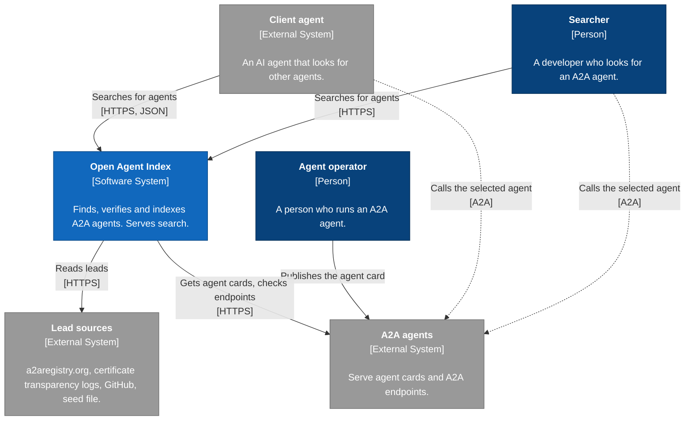
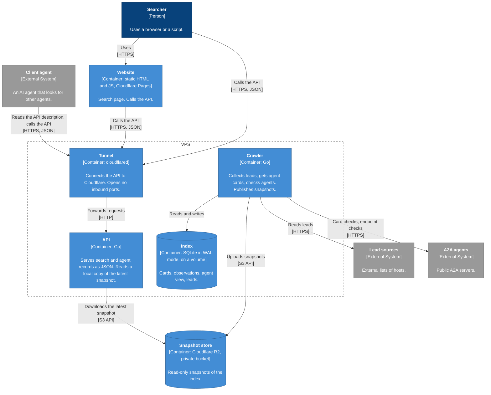
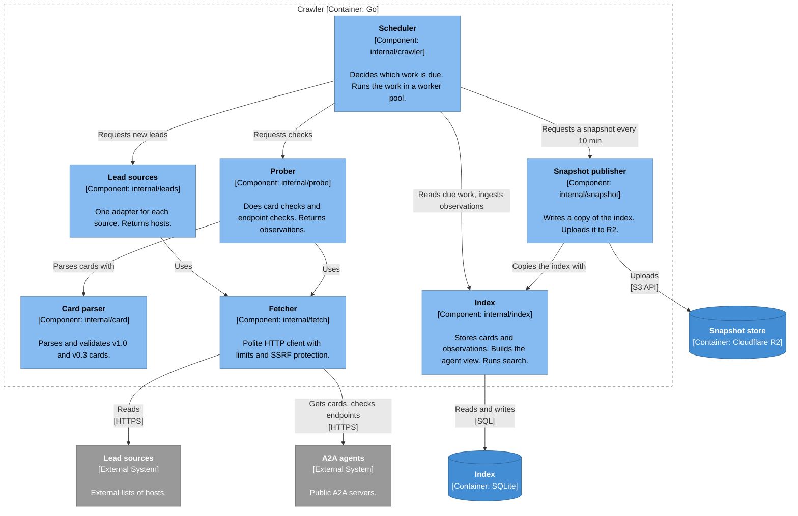
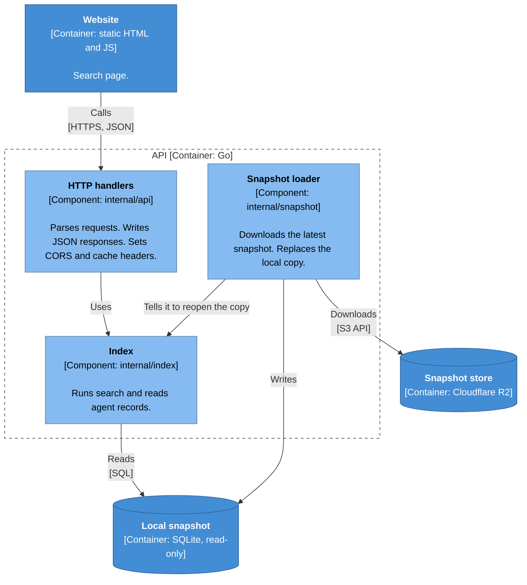
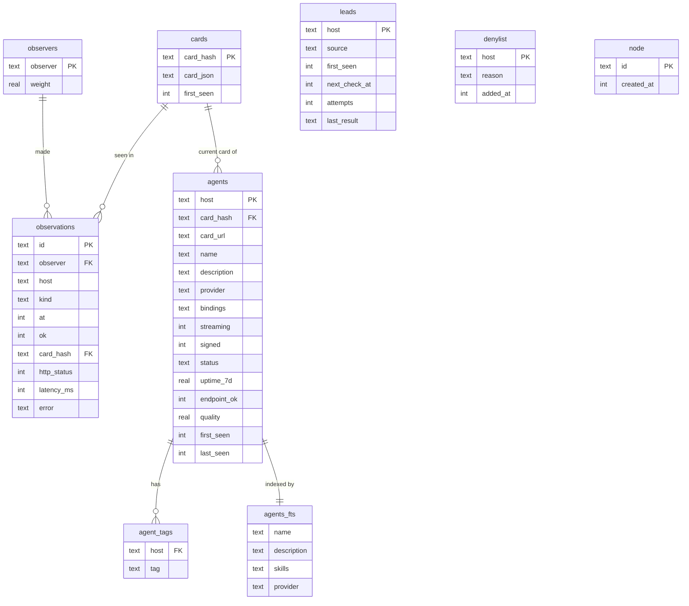
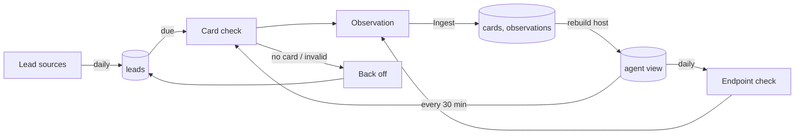
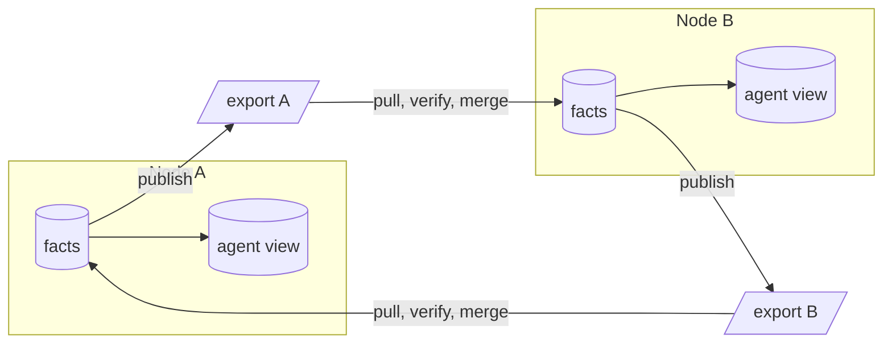

# Open Agent Index — Specification

Status: draft. This document defines the MVP. Change it before you change the design.

## 1. Purpose

Open Agent Index finds A2A agents on the public internet. It verifies them, keeps them in an index and lets people and agents search the index.

### 1.1 Goals

- Find more live A2A agents than the current registries.
- Get each agent card from the agent's own domain.
- Show which agents are live, and how reliable they are.
- Give search results to people through a static website.
- Give search results to agents through a REST API. Describe the API so that agents can use it without help.

### 1.2 Non-goals

- Do not index MCP servers or other non-A2A services.
- Do not operate as an A2A agent. Do not supply an A2A or MCP endpoint.
- Do not send tasks to agents. Do not test agent skills.
- Do not verify agent card signatures. Record only if a signature is present.
- Do not supply accounts, payments or owner claims.
- Do not scan large ranges of domains.
- Do not synchronize with other nodes. Section 14 shows how to add this later.

## 2. Terms

| Term | Meaning |
|---|---|
| Agent | An A2A server that serves an agent card at a well-known path of its host. |
| Host | The DNS name that serves the agent card. The host identifies the agent. |
| Agent card | The JSON document at `/.well-known/agent-card.json`. Version 0.3 also uses `/.well-known/agent.json`. |
| Lead | A host that can possibly serve an agent card. |
| Lead source | An external list that supplies leads. |
| Card check | A request for the agent card. |
| Endpoint check | A request to an A2A endpoint of the agent. |
| Node | One installation of Open Agent Index. Each node has a UUIDv7 node ID. |
| Observer | The node that did a check. |
| Observation | The record of one check: observer, host, kind, time and result. |
| Agent view | The current state of each agent. The index calculates it from cards and observations. |

## 3. System context (C4 level 1)



## 4. Containers (C4 level 2)



| Container | Runs as | Notes |
|---|---|---|
| Website | Cloudflare Pages | Source in `web/`. No build step. |
| Tunnel | Container on the VPS | Official `cloudflare/cloudflared` image. |
| API | Container on the VPS | Does not use the crawler volume. It can run on a different host. |
| Crawler | Container on the VPS | The only writer to the index. Runs all the time. |
| Index | File on the crawler volume | Used only by the crawler. |
| Snapshot store | Cloudflare R2 | Private bucket. Also keeps the backups. |

### 4.1 Snapshots

- Every 10 min, the crawler writes a copy of the index with `VACUUM INTO`. It uploads the copy to R2 as `snapshots/<UTC time>.db`. Then it writes the object `latest` with the name of that copy.
- Every 1 min, the API reads `latest`. If the name changed, the API downloads the copy, opens it read-only and replaces the old copy.
- Search results can be up to approximately 11 min older than the index.
- A lifecycle rule on the bucket deletes snapshots that are older than 7 days. The other snapshots are the backups.

## 5. Components (C4 level 3)

### 5.1 Crawler



### 5.2 API



### 5.3 Packages

| Package | Responsibility | Exported API (summary) |
|---|---|---|
| `internal/card` | Parse and validate agent cards. Make one model from v1.0 and v0.3. | `Parse(data) (Card, error)` |
| `internal/fetch` | Do HTTP requests with the limits in section 7.3. | `Client.Get(ctx, url)`, `Client.Post(ctx, url, body)` |
| `internal/leads` | Read leads from each source. | `Source` adapters that return hosts |
| `internal/probe` | Do card checks and endpoint checks. Return one observation for each check. | `CheckCard(ctx, host)`, `CheckEndpoint(ctx, card)` |
| `internal/index` | Own the schema, the writes, the reads and the search. Build the agent view. | `Ingest(ctx, observation)`, `Search(ctx, query)`, `Agent(ctx, host)`, lead methods |
| `internal/crawler` | Schedule the work. Connect the packages above. | `Run(ctx)` |
| `internal/api` | Serve HTTP. | `Handler(index) http.Handler` |
| `internal/snapshot` | Publish snapshots to R2. Load the latest snapshot from R2. | `Publisher.Publish(ctx)`, `Loader.Run(ctx)` |

Each package defines the interfaces that it uses. The `cmd/` binaries only read configuration and connect packages.

The card parser uses `github.com/a2aproject/a2a-go/v2` for v1.0 cards and its `a2acompat/a2av0` package for v0.3 cards. The index uses `modernc.org/sqlite`. This is pure Go, so the images need no C toolchain. The snapshot package uses an S3-compatible client for R2.

## 6. Data model

The index has three kinds of tables. This makes it possible to merge indexes from different nodes in the future (section 14).

| Kind | Tables | Rules |
|---|---|---|
| Facts | `cards`, `observations` | Insert only. Never update a row. The key does not depend on the node that stores the row. |
| Derived | `agents`, `agent_tags`, `agents_fts` | Calculate from the facts and the local state. Rebuild at any time. |
| Local state | `leads`, `denylist`, `observers`, `node` | Decisions of this node only. |



Keys:

| Table | Key | Reason |
|---|---|---|
| `cards` | SHA-256 of the card in canonical JSON (RFC 8785) | Two nodes that get the same card make the same key. |
| `observations` | UUIDv7 | The observer sets the ID one time. The ID never changes. The time order of UUIDv7 keeps inserts and pruning fast. |
| `agents` | Host | The host identifies the agent. |

Rules:

- `Ingest` is the only method that writes facts. It inserts the observation and its card with `INSERT OR IGNORE`. Then it rebuilds the agent view of that host.
- `cards.card_json` holds the canonical JSON. The index does not parse cards. The agent view reads the protocol version and the other fields from `card_json`.
- `observations.kind` is `card` or `endpoint`. `observations.card_hash` is set when a card check gets a valid card.
- The current card of an agent is the newest valid card from an observer with a weight more than 0.
- `observers` holds this node with weight 1. In the MVP, there are no other observers.
- `node` holds one row. The node creates it at the first start.
- `agents.status` is `live`, `degraded` or `gone`. See section 7.5.
- `agents_fts` is an FTS5 table. `skills` holds the skill names, descriptions, tags and examples.
- The view does not include hosts in `denylist`.
- Times are Unix seconds.
- The index deletes observations that are older than 30 days. Then it deletes cards that no row refers to.

## 7. Crawler

### 7.1 Work loop



### 7.2 Lead sources

| Source | Method | Interval |
|---|---|---|
| Seed file | Hosts in `seeds.txt`, one for each line. | At start |
| a2aregistry.org | `GET /api/agents`, all pages. Use only the host of `wellKnownURI`. | Daily |
| Certificate transparency | Query crt.sh for names that start with `agent.`, `agents.` or `a2a.`. Best effort: crt.sh is slow and can fail. | Daily |
| GitHub | Code search for files named `agent-card.json`. Use the hosts in their `url` fields. Needs a token. | Daily |

The crawler uses a lead source only for hosts. It does not copy other data from a source.

### 7.3 Fetch rules

- Use HTTPS only.
- Send `User-Agent: OpenAgentIndexBot/<version> (+<contact URL>)`.
- Obey `robots.txt` for this user agent.
- Do one request at a time to each host. Wait at least 1 s between requests to the same host.
- Use a global limit of 64 requests at the same time.
- Stop each request after 10 s.
- Read a maximum of 1 MiB from each response.
- Follow a maximum of 5 redirects.
- Do not connect to loopback, private, link-local or multicast addresses. Check the address after DNS resolution and on each redirect. This prevents SSRF.

### 7.4 Checks

**Card check.** Get `https://<host>/.well-known/agent-card.json`. If the response is 404, get `/.well-known/agent.json`. Parse and validate the card. Make an observation with the result and the latency.

**Endpoint check.** Send a request that does no work on the agent: get a task that does not exist, with a random ID.

| Binding | Request | Pass condition |
|---|---|---|
| JSON-RPC, v1.0 | `GetTask` | A JSON-RPC response or error |
| JSON-RPC, v0.3 | `tasks/get` | A JSON-RPC response or error |
| HTTP+JSON | `GET /tasks/<id>` | An A2A error body |

The crawler never sends `SendMessage`. This prevents costs and payments for the agent operator.

Each check makes one observation. The crawler gives it to `Ingest`.

### 7.5 Schedule and status

| Item | Value |
|---|---|
| New lead | Check when found. |
| Lead without a card | Check again after 30 days. |
| Lead with an error | Check again after 1 h, 6 h, 24 h, then every 7 days. |
| Known agent, card check | Every 30 min. |
| Known agent, endpoint check | Every 24 h. |
| `live` | The newest card observation passed, and an endpoint observation passed in the last 48 h. |
| `degraded` | The newest card observation passed, but no endpoint observation passed in the last 48 h. |
| `gone` | All card observations failed for 7 days. Search does not show `gone` agents. |

The index uses only observations from observers with a weight more than 0.

### 7.6 Opt-out

- The crawler obeys `robots.txt`.
- The crawler skips hosts in `denylist`.
- The website shows a contact address for removal requests.

## 8. Search

The API searches `agents_fts` with FTS5. It does not show `gone` agents or hosts in `denylist`.

```
score = relevance × quality
relevance = −bm25(agents_fts)        (weights: name 4, skills 2, description 1, provider 1)
quality   = 0.2 + 0.8 × (0.6 × uptime_7d + 0.3 × endpoint_ok + 0.1 × signed)
```

- `uptime_7d` = Σ(weight × ok) / Σ weight, for the card observations of the last 7 days.
- `endpoint_ok` is 1 if an endpoint observation passed in the last 48 h. Else it is 0.
- `weight` is the weight of the observer in `observers`. In the MVP, all observations have weight 1.
- `signed` is 1 if the card has signatures. Else it is 0.
- If the query is empty, sort by `quality`.

These weights are initial values. Tune them with real data.

## 9. REST API

All responses are JSON. The base path is `/v1`.

| Method and path | Purpose |
|---|---|
| `GET /v1/search` | Search agents. |
| `GET /v1/agents/{host}` | Get one agent: the agent view, the current card and the newest observations. |
| `GET /v1/stats` | Get counts: leads, agents for each status, protocol versions. |
| `GET /openapi.json` | Get the OpenAPI 3.1 description of this API. |
| `GET /llms.txt` | Get a short plain-text guide for language models: what the index contains and how to search it. |
| `GET /healthz` | Get the API health. |

`GET /v1/search` parameters:

| Name | Default | Values |
|---|---|---|
| `q` | empty | Free text |
| `tag` | none | A skill tag. Repeat for more tags. |
| `status` | `live` | `live`, `degraded`, `any` |
| `binding` | any | `JSONRPC`, `HTTP+JSON`, `GRPC` |
| `version` | any | `1.0`, `0.3` |
| `limit` | 20 | 1 to 100 |
| `offset` | 0 | 0 or more |

Search result item:

```json
{
  "host": "echo-agent.mattiapapaccioli.com",
  "name": "Echo Agent",
  "description": "Echoes your messages back.",
  "card_url": "https://echo-agent.mattiapapaccioli.com/.well-known/agent-card.json",
  "protocol_version": "1.0",
  "bindings": ["JSONRPC", "HTTP+JSON"],
  "skills": [{"id": "echo", "name": "Echo", "tags": ["test", "echo"]}],
  "streaming": true,
  "signed": false,
  "status": "live",
  "uptime_7d": 0.98,
  "last_checked": 1792000000
}
```

- Errors use the body `{"error": "<message>"}` and a 4xx or 5xx status.
- Send `Access-Control-Allow-Origin` with the website origin.
- Send `Cache-Control: public, max-age=60` on search and agent responses.
- Keep `/openapi.json` and `/llms.txt` in the repository. Serve them from the API binary.
- Write a description for each operation and each parameter. Agents select and call operations from these descriptions.

## 10. Website

- Static HTML, CSS and JavaScript in `web/`. No framework.
- One search page with filters, and one page for each agent.
- Show agent card text as text only. Never insert it as HTML. Agent cards are untrusted input.
- If the API does not respond, show a message that search is not available.

## 11. Deployment

- One VPS with 2 vCPU and 4 GB RAM is sufficient.
- A compose file starts `crawler`, `api` and `tunnel`. The crawler uses the volume `oai-data`. The API uses the volume `oai-cache` for its local snapshot.
- One `Containerfile` builds both binaries. It uses `golang:1.27` to build and `gcr.io/distroless/static` (non-root) to run.
- The crawler and the API log JSON to stdout with `log/slog`.
- The snapshots in R2 are the backups. See section 4.1.

Configuration (environment variables):

| Variable | Used by | Purpose |
|---|---|---|
| `OAI_DB_PATH` | crawler | Path of the SQLite file |
| `OAI_CONTACT_URL` | crawler | URL in the user agent |
| `OAI_GITHUB_TOKEN` | crawler | Token for GitHub code search |
| `OAI_SEEDS_PATH` | crawler | Path of `seeds.txt` |
| `OAI_LISTEN_ADDR` | api | Listen address, for example `:8080` |
| `OAI_CORS_ORIGIN` | api | Website origin |
| `OAI_SNAPSHOT_DIR` | api | Directory for the local snapshot |
| `OAI_R2_ENDPOINT` | crawler, api | R2 S3 endpoint |
| `OAI_R2_BUCKET` | crawler, api | Bucket name |
| `OAI_R2_ACCESS_KEY_ID`, `OAI_R2_SECRET_ACCESS_KEY` | crawler, api | R2 credentials. The API needs read access only. |

## 12. Tests

- Unit tests do not use the network. They use `net/http/httptest`.
- `internal/card` uses fixture cards in `testdata/`: valid v1.0, valid v0.3, and invalid cards.
- `internal/fetch` tests the limits, `robots.txt` and the SSRF block.
- `internal/index` uses a temporary SQLite file. It tests that:
  - `Ingest` of the same observation two times stores one row.
  - Two equal cards with different key order or whitespace get the same `card_hash`.
  - A rebuild of the agent view from the facts gives the same view as the incremental updates.
- `internal/api` checks that `/openapi.json` is valid OpenAPI 3.1 and agrees with the routes.
- `internal/snapshot` uses an in-memory object store behind its storage interface. The tests do not use R2.
- A manual end-to-end test runs the crawler with `echo-agent.mattiapapaccioli.com` in `seeds.txt`. The agent must become `live`.

## 13. Milestones

| # | Result |
|---|---|
| M1 | `card`, `fetch`, `index`. The crawler reads the seed file and a2aregistry.org. A report shows the found agents. |
| M2 | Card checks, endpoint checks, status and backoff. |
| M3 | Certificate transparency and GitHub lead sources. Coverage report against a2aregistry.org. |
| M4 | REST API with search and ranking, `/openapi.json` and `/llms.txt`. In development, it reads a local SQLite file. |
| M5 | Snapshots to R2, `Containerfile`, compose file, VPS deployment. |
| M6 | Website on Cloudflare Pages. |

## 14. Future: decentralized sync

This section is not part of the MVP. It shows how nodes can share the index later. The data model in section 6 supports it without changes to the fact tables.



- **Export.** Each node publishes its facts at a public URL. The format is JSONL: one card or one observation on each line, with a `format_version` field. Nodes exchange exports, not SQLite files, because the schema can change between versions.
- **Peers.** Each node has a list of peer export URLs. It pulls each export on a schedule.
- **Merge.** Insert the facts with `INSERT OR IGNORE`. Then rebuild the derived tables. The result is the same in any order and after any number of merges. Never merge local state.
- **Trust.** Each node gets a key pair and signs its observations. The node accepts only observations with a valid signature. The weight in `observers` sets the trust in each observer. An unknown observer has weight 0.
- **Checks on import.** Calculate `card_hash` again from the card. Reject observations with a time more than 5 min in the future. Do not import observations that are older than 30 days.
- **Transport.** Start with the pull of exports. Later, Nostr relays can send the same records faster. The merge does not change.
- **Website.** The website can download a public export and search it in the browser. Then search works without the API.

## 15. Open questions

- Domain name for the website and the API.
- VPS provider.
- Use of the Agenstry bulk feed as a lead source. Read its terms first.
- Contact address for removal requests.
